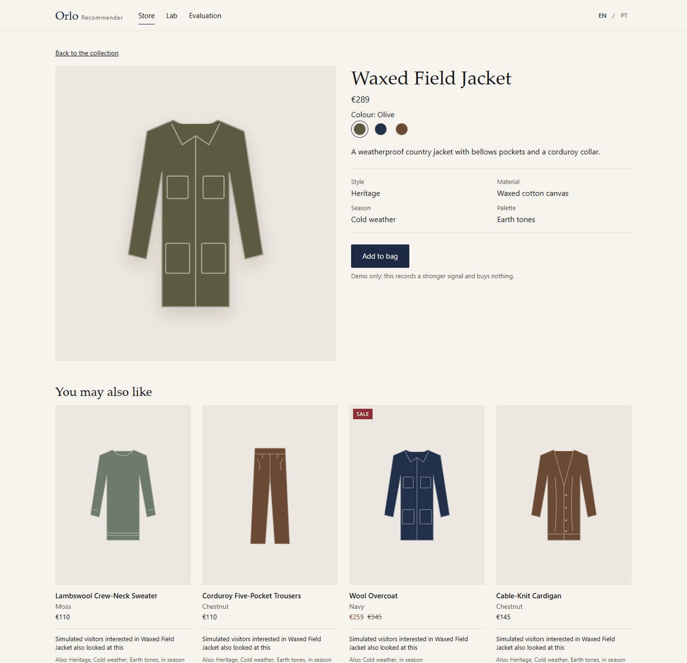
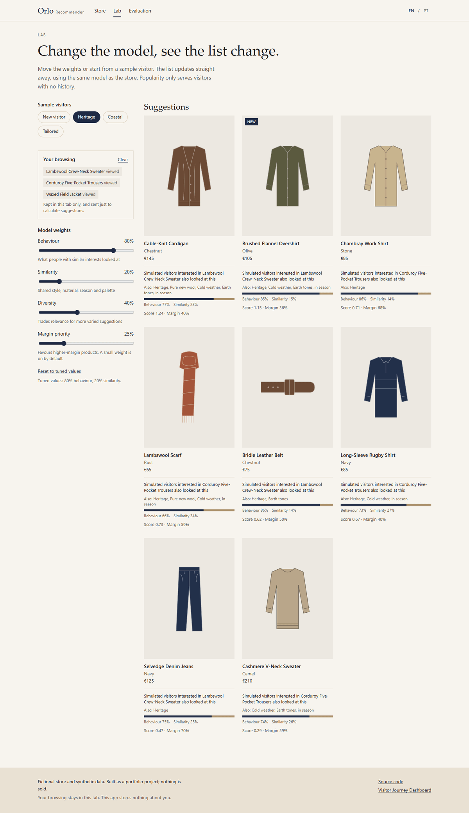
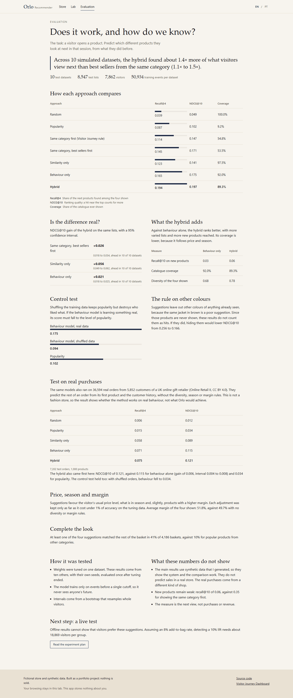

# Orlo Recommender

An explainable hybrid product recommender for Orlo, a fictional premium menswear store. Open a few products and the suggestions adapt. Each one says why it is there and how much each model contributed.

It is the companion to [Visitor Journey Dashboard](https://github.com/CristovaoMonteiro/VisitorJourney): same brand and event format, but a separate app with its own larger catalogue. All data is synthetic.

**Live demo:** [orlo-recommender.onrender.com](https://orlo-recommender.onrender.com) · **Lab:** [`/lab`](https://orlo-recommender.onrender.com/lab) · **Evaluation:** [`/evaluation`](https://orlo-recommender.onrender.com/evaluation)

> Hosted on Render's free tier: after 15 minutes without traffic the service sleeps, so the first request can take up to a minute.



## What you can do

- **Store:** browse 40 garments in three colours each, in English or Portuguese, and watch "Recommended for you" change as you go.
- **Product page:** see "You may also like" and "Complete the look", each with its reason.
- **Lab:** move the model weights and the diversity setting, or start from a sample visitor, and see the list update.
- **Evaluation:** read how the hybrid compares with simpler approaches, where it falls short, and how a live test would judge it.



## How it works

| Part                  | Approach                                                                                  | Why                                                                                                    |
| --------------------- | ----------------------------------------------------------------------------------------- | ------------------------------------------------------------------------------------------------------ |
| Similarity            | TF-IDF over product attributes and descriptions                                           | Works for products with no interactions                                                                |
| Behaviour             | Item-to-item cosine on implicit feedback, with shrinkage                                  | Every score traces back to a product the visitor touched, which makes it explainable                   |
| Hybrid                | 80% behaviour and 20% similarity, tuned on validation data                                | Beat each model alone on simulated and real data                                                       |
| No history            | Best sellers                                                                              | Popularity only serves visitors with nothing else to go on                                             |
| Thin data             | Weight moves to similarity and to behaviour borrowed from similar products, at a discount | New products stay reachable without outranking proven ones                                             |
| Price, season, margin | Small adjustments to the final score                                                      | Keeps suggestions near the visitor's price level and in season, without bending results towards margin |
| Diversity             | MMR re-ranking, plus one colour per line in a list                                        | Avoids four near-identical suggestions                                                                 |
| Other colours         | Grouped into one product with a colour selector, and hidden from suggestions once seen    | The same jacket in brown is not a discovery                                                            |
| Complete the look     | Basket lift across categories, weighted by content match                                  | Going with something differs from resembling it                                                        |

The store data comes from a seeded generator: 4,000 visitors with hidden tastes produce about 60,000 views, bag additions and purchases over 90 days. The hidden tastes exist only to generate events, and the models never read them.

## Privacy

There is no database, account, cookie or tracker. Your browsing stays in `sessionStorage`, which is deleted when the tab closes, and you can clear it at any time. It reaches the server only as the body of a recommendation request, which is answered and not stored. The rate limiter holds your IP address in memory for one minute and never writes it to disk or logs. The hosting provider may keep its own access logs.

## Evaluation

There are two evaluations: one on a simulated store with ten datasets, and one on real purchases from a different kind of shop. Both report results from data that played no part in tuning.

### Simulated store

`npm run evaluate` reproduces these numbers and writes them to [data/evaluation.json](data/evaluation.json).

**Task:** a visitor opens a product. Given that product and their earlier history, predict which different products they look at next in the same session. Other colours of products already seen are never suggested, so they are not counted as hits.

**Protocol:** settings were tuned on one synthetic dataset. The results below come from ten other datasets, each with its own seed, evaluated once after tuning ended. The model trains only on events before a single cutoff, so it never sees anyone's future. Intervals are 95% bootstrap, resampling whole visitors.

Visitors follow traits of each garment that no product attribute reveals, so the content model cannot read the answer from the catalogue. Demand also moves from warm-weather to cold-weather products.

| Ranker                                                 | Recall@4  | NDCG@10   | Coverage@4 |
| ------------------------------------------------------ | --------- | --------- | ---------- |
| Random                                                 | 0.039     | 0.049     | 100%       |
| Popularity                                             | 0.087     | 0.102     | 9.2%       |
| Same category first (the Visitor Journey store's rule) | 0.114     | 0.147     | 54.8%      |
| Same category, best sellers first                      | 0.145     | 0.171     | 53.5%      |
| Content only                                           | 0.123     | 0.141     | 97.5%      |
| Collaborative only                                     | 0.165     | 0.175     | 92.0%      |
| **Hybrid**                                             | **0.194** | **0.197** | **89.3%**  |

Test set: 8,547 lists from 7,862 simulated visitors. Every ranker follows the same rule on other colours.

Hybrid NDCG@10 minus each alternative, on the same lists:

| Compared with                     | Difference | 95% interval   | Datasets ahead |
| --------------------------------- | ---------- | -------------- | -------------- |
| Same category, best sellers first | +0.026     | 0.018 to 0.034 | 10 of 10       |
| Content only                      | +0.056     | 0.049 to 0.062 | 10 of 10       |
| Collaborative only                | +0.021     | 0.018 to 0.025 | 10 of 10       |

**The main finding:** the hybrid finds about 1.4× more of what visitors view next than best sellers from the same category (1.1× to 1.5× across datasets), and it beats each model alone. Against collaborative filtering it also shows more varied lists (diversity 0.78 against 0.68) and reaches more new products (recall@10 of 0.06 against 0.03). Its catalogue coverage is lower (89.3% against 92.0%), because it follows price and season.

**Control:** when the training events are shuffled, which keeps popularity but destroys who liked what, the collaborative model falls from 0.175 to 0.094, level with popularity at 0.102. Its score therefore comes from the behavioural signal.

**Complete the look:** at least one of the four suggestions matched the rest of the basket in 41% of 4,186 baskets, against 10% for the most popular products from other categories.

**Price, season and margin:** each adjustment was kept only as far as it cost under 1% of accuracy on the tuning data. With them, the average margin of the four products shown is 51.8%, against 49.7% with no diversity or margin rules, with no measurable loss of accuracy (difference +0.001, interval -0.001 to 0.004). Margins are fictional.

### Real purchases

`npm run evaluate:real` reproduces these numbers and writes aggregates to [data/evaluation-real.json](data/evaluation-real.json). The source data stays out of this repository.

The same models ran on [Online Retail II](https://archive.ics.uci.edu/dataset/502/online+retail+ii) (D. Chen, UCI Machine Learning Repository, CC BY 4.0): 36,594 orders from 5,852 customers of a UK online gift retailer, between 2009 and 2011. The task is to predict the rest of an order from its first product and the customer's history, across the 1,000 best-selling products before the test period. Tuning stopped at the end of May 2011, and the test covers the 7,202 orders from 3,236 customers after that. Diversity, season and margin rules are not used here.

| Ranker             | Recall@4  | NDCG@10   | Coverage@4 |
| ------------------ | --------- | --------- | ---------- |
| Random             | 0.006     | 0.012     | 100%       |
| Popularity         | 0.015     | 0.034     | 4.0%       |
| Content only       | 0.058     | 0.089     | 91.5%      |
| Collaborative only | 0.071     | 0.115     | 81.7%      |
| **Hybrid**         | **0.075** | **0.121** | **86.8%**  |

The hybrid beats collaborative filtering by +0.006 (interval 0.004 to 0.008) and popularity by +0.087 (0.083 to 0.092). With shuffled orders, collaborative filtering falls from 0.115 to 0.034, exactly level with popularity. This is the strongest evidence in this project that the method works on real behaviour. It is not evidence of what Orlo would achieve: this is a gift shop, and the task is completing an order, not browsing.

### How this evaluation changed

Each round used datasets the previous rounds had not seen.

1. The first run exposed two flaws: the collaborative baseline was still falling back on content, and new products were outranking proven ones.
2. A review found that nearly 40% of suggestions were other colours of something already seen, and that one test dataset overstated the headline.
3. A later version stopped counting hidden colours as hits.
4. The generator then gained traits that the catalogue does not reveal. This made the task harder and cut the headline from about 2.3× to about 1.4×. The earlier figures were inflated by a generator that favoured the content model.

### Limits

- **The main results are synthetic.** I wrote the generator, so they show that the pipeline works and that the comparison is sound. They do not predict sales in a real store.
- **The real test is a different business.** A UK gift shop's orders say little about a menswear store's sessions.
- **New products remain weak.** Hybrid recall@10 on products with fewer than 30 visitors is 0.06, against 0.35 for showing the same category first, and 0.22 for content only.
- **The rule on other colours is a product decision.** If those views did count as hits, hiding them would lower NDCG@10 from 0.256 to 0.166. The same jacket in another colour is a poor suggestion, so the rule stays, and each product page has a colour selector instead.
- **Neither evaluation measures revenue.** One measures next views and the other measures items in the same order.

**Next step:** [docs/experiment-plan.md](docs/experiment-plan.md) sets out how a live A/B test would decide whether this should ship, with metrics, guardrails, sample size and decision rules. It has not been run.



## API

| Route                                          | Purpose                                  |
| ---------------------------------------------- | ---------------------------------------- |
| `POST /api/recommendations`                    | Ranked, explained products for a history |
| `GET /api/look/:productId`                     | Products that complete the look          |
| `GET /api/products`, `GET /api/products/:slug` | Catalogue                                |
| `GET /api/settings`                            | Tuned weights and diversity              |
| `GET /api/evaluation`                          | Published evaluation results             |
| `GET /api/health`                              | Health check                             |

```bash
curl -X POST http://localhost:3000/api/recommendations \
  -H "Content-Type: application/json" \
  -d '{"history":[{"productId":"p001","type":"view_product"}],"k":4}'
```

`history` holds up to 50 entries, oldest first, with `view_product`, `add_to_cart` or `purchase` as the type. `contextProductId`, `k`, `weights` (`collaborative` and `content`), `diversity` and `marginWeight` are optional. Requests are validated, unknown fields are rejected, and recommendation routes allow 120 requests per minute.

## Project structure

```text
data/                 catalogue, published model and evaluation results
docs/                 experiment plan and screenshots
public/               store, lab and evaluation pages
scripts/
  build-catalogue.js  expands 40 garment lines into 120 products
  build-model.js      trains the published model
  evaluate.js         tunes, tests and writes the simulated results
  evaluate-real.js    runs the models on real purchases
  prepare-retail.py   converts the public dataset for that run
  data/               seeded visitor and event generator
  evaluation/         metrics, test cases and baselines
server/
  recommender/        models, hybrid and settings
  routes/             API
tests/                unit, API and evaluation tests
e2e/                  browser and accessibility checks
```

## Local setup

Requires Node 20.19+.

```bash
npm install
npm run dev
```

The app runs at http://localhost:3000.

To rebuild the generated files:

```bash
npm run catalogue
npm run model
npm run evaluate
```

To rerun the test on real purchases, download the spreadsheet from the dataset page, then:

```bash
pip install openpyxl
python scripts/prepare-retail.py online-retail-ii.xlsx retail.csv
node --max-old-space-size=4096 scripts/evaluate-real.js retail.csv
```

## Checks

```bash
npm run lint
npm run format:check
npm test
npm run test:e2e
```

`test:e2e` needs Chrome or Edge, and runs in CI along with the others. Set `CHROME_PATH` if it is not found.

## Deploy

[render.yaml](render.yaml) describes one free web service in Frankfurt. In Render, choose **New > Blueprint** and select this repository. There are no secrets to set. Free services sleep when idle, so the first visit can take up to a minute.

## License

MIT
